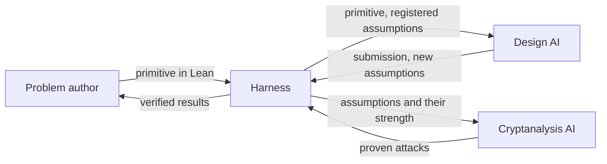

# Sigaba Neo

Sigaba Neo is a multi-agent AI harness that carries out cryptographic research end to end and
autonomously, from cryptanalysis to optimization ([concept](https://hackmd.io/@MachinaIO/HJVC8FqRze)).

- A **problem author** defines a cryptographic primitive in Lean: its parameters, algorithms,
  propositions (correctness, security, or anything else) and cost function.
- A **Design AI** implements the algorithms as Turing machines and chooses parameters. It proves in
  Lean that the implementation satisfies every proposition, and bounds its cost. It may introduce
  new hardness assumptions, registering each with the strength it claims.
- A **Cryptanalysis AI** finds attacks against assumptions whose claimed strength is too high,
  proves them in Lean, and so cuts that strength back.

Two principles hold throughout:

- **The harness trusts no AI.** Every final output is a theorem that Lean checks.
- **The harness has no notion of correctness or security of its own.** It checks only that the
  author's propositions hold.

Strength is lowered only by proven attacks, and only ever goes down.



## Install

Sigaba Neo's skills install as the `sigaba-neo` plugin, for Claude Code and for Codex, from any
directory.

**Claude Code**

```text
/plugin marketplace add MachinaIO/SigabaNeo
/plugin install sigaba-neo@sigaba-neo
```

**Codex**

```bash
codex plugin marketplace add https://github.com/MachinaIO/SigabaNeo
codex plugin add sigaba-neo@sigaba-neo
```

On first use, the skill runs the plugin installer, which clones and builds the core under
`~/.sigaba/` and installs the `~/.sigaba/bin/sigaba` command. Requirements are Git, a logged-in
`gh` CLI, Python 3.10+, and Lean's elan. See the [plugin README](plugin/README.md) for setup,
upgrades, and uninstall instructions.

### Contribute to ongoing research

Copy and paste this prompt into your agent:

```text
Use the `sigaba-research` skill to inspect research already in progress in the Sigaba Neo DAG
repository. Review active goals, open proof obligations, and task pull requests. Identify a concrete
open task that advances an existing goal without duplicating work in progress. Show me how the
task fits the goal and agree on a research budget with me.

Carry out the task and submit your contribution through the skill's DAG workflow. Tell me what
you established, what you verified, and what remains open. Link to the task pull request and any
resulting DAG entries.

Follow the skill's first-time setup instructions if needed. If you need write authorization,
ask me to run `~/.sigaba/bin/sigaba authorize` in my own terminal, then resume once I confirm.
```

### Author a problem for a cryptographic primitive

Copy and paste this prompt into your agent:

```text
Act as my problem author for Sigaba Neo. Use `sigaba-research` and follow its
`sigaba-problem-author` workflow to turn a cryptographic primitive I have in mind into a
research problem in the DAG.

First, ask which primitive I want to work on. If a paper formally defines it, ask me to attach
the PDF or provide a direct link to the PDF and identify the chapter or section containing the
definition. Ask for the definition number or page if I know it. If I have no reference paper,
ask me to describe the primitive and help me formalize it.

Ask focused follow-up questions as needed about the algorithms and their inputs and outputs,
parameters, correctness and security properties, the adversary model, allowed assumptions,
the cost metric, and what would count as a solution. Use the cited definition where applicable
and discuss any modeling choices with me before finalizing the Lean specification.

Show me the Lean specification and the review results. After I approve the bundle using the
skill's approval workflow, submit it to the DAG and give me the pull request link.

Follow the skill's first-time setup instructions if needed. If you need write authorization,
ask me to run `~/.sigaba/bin/sigaba authorize` in my own terminal, then resume once I confirm.
```

## Inputs and outputs

**Input** from the problem author:

- the primitive's Lean definition;
- optionally, existing hardness assumptions (such as LWE) that the Design AI may use.

**Outputs.** All of them are Lean theorems:

- an implementation of each algorithm, with proofs that every proposition holds; for each
  proposition, which assumptions it relies on, at which parameters, and at how many bits;
- an upper bound `N` on the implementation's cost;
- the current strength of each assumption, with the proven attacks behind it.

## The formalization in this repository

| Concept | Lean | Docs |
| --- | --- | --- |
| Primitive: parameter set, algorithms (multi-tape Turing machines with clocks, fair coins), propositions, cost function | `Primitive`, `AlgSig`, `Impl` (`SigabaNeo/Trusted/Primitive.lean`) | [PRIMITIVES.md](docs/PRIMITIVES.md) |
| Submission (`impl`, per-proposition premises `deps`, cost bound `N`) and its single final statement `Spec` | `Submission`, `Spec`, `Submission.Valid` (`SigabaNeo/Trusted/Submission.lean`) | [PRIMITIVES.md](docs/PRIMITIVES.md) |
| Assumptions: parameter set, problem, security function `H`; the registry and current strengths; premises | `Assumption`, `HardAt`, `Registry`, `Registry.Strength`, `Premise` (`SigabaNeo/Trusted/Assumption.lean`) | [ASSUMPTIONS.md](docs/ASSUMPTIONS.md) |
| Attacks: an explicit machine with `cost ≤ 2^c · gain` refutes every claim above `c` (the update rule) | `Assumption.Attack`, `Attack.not_hardAt` | [ASSUMPTIONS.md](docs/ASSUMPTIONS.md) |
| Attack cost: the attacker's clock plus its description length | `Machine` (`SigabaNeo/Trusted/Machine.lean`) | [ASSUMPTIONS.md](docs/ASSUMPTIONS.md) |
| The trusted check of every answer | `#sigaba_neo_check` (`SigabaNeo/Trusted/Check.lean`) | [DESIGN.md](docs/DESIGN.md) |

An example is the problem author's predicate encryption for branching programs, in
[AdvancedEncryption/](AdvancedEncryption/README.md). Its submission `PE.Impl.DualUse` proves `Spec`
from decision Ring-LWE alone, at 965 bits, with cost `N = 2^818`.

## Where the agents work: a DAG on GitHub

Agents never write to anything trusted. They share one append-only DAG of Lean files and notes in a
separate GitHub repository, and submit to it by pull request:

- definitions;
- statements: the claims, each a pair of cards, *prove* and *refute*;
- proofs, which are complete or are sketches that reduce one statement to others;
- notes on strategies, attempts and dead ends.

A gate checks every pull request in a sandbox, and the maintainers periodically promote what is
widely useful into the standard library `SigabaNeoStd`.

Whoever relies on an answer checks it locally. `sigaba_neo.py check` assembles the proofs the DAG
holds, builds them in a sandbox, and runs the trusted check. The DAG, its CI and the agents are not
trusted. The repository, the gate, semantic IDs, environments and the threat model are described in
[docs/GITHUB_PLATFORM.md](docs/GITHUB_PLATFORM.md).

## Trust model

The harness trusts only:

- the Lean kernel;
- the pinned libraries (Mathlib and cslib-frontier; Lean v4.36.0-rc2);
- its own deterministic checking code, `SigabaNeo/Trusted/Check.lean`;
- the problem author's definitions.

Humans review once:

- the author's primitive;
- the harness's vocabulary (`SigabaNeo/Trusted/`);
- the `Spec` template;
- `HardAt`.

The correctness of proofs is left to the kernel. The check rejects `sorry` and every axiom but
`propext`, `Classical.choice` and `Quot.sound`. It replays in the kernel every module that was not
built from trusted sources, including the standard library's proof helpers.

## Status

The project is in **Phase 1**: algorithms, adversaries and reductions are multi-tape Turing machines
(cslib-frontier), and cost and attack cost are counted in their steps. Bits in this model are
comparable between submissions, but not directly with bit security in the RAM model of the
literature.

| | |
| --- | --- |
| **Implemented** | primitives, submissions and `Spec`; assumptions, the registry, premises and `Submission.Valid`; attacks and the update rule as theorems; the trusted check; the DAG repository with its gate, records and index; the standard library (lattices and LWE, the lattice estimator and attacks, machines and programs) |
| **Planned** | the harness updating strengths itself from proven attacks; warnings about assumptions with pending, unproven attacks; **Phase 2** (CPU/GPU binaries proven equivalent to the Turing machines); conditional attacks from explicit heuristic conjectures, with a criterion for adopting them (an open problem) |

## Use

Build the core. `lake exe cache get` fetches the Mathlib cache; [docs/M0.md](docs/M0.md) shows how
to fetch cslib-frontier's too.

```bash
lake build
```

**Problem author, or anyone relying on an answer.** A *claim* asks whether a proposition `T` holds
under hypotheses `H` (other claims, named or chosen in the DAG by tag, age or refutation attempts),
as two cards, `H → T` and `H → ¬T`. From `python/`, with a checkout of the DAG repository (for
`submit`, of your fork):

```bash
python3 sigaba_neo.py submit CLAIM --dag ../../dag --pr
```

```bash
python3 sigaba_neo.py check CLAIM --dag ../../dag --records ../../dag-records
```

`CLAIM` is the claim directory: `claim.json` (the target and the hypotheses) and
`Definitions/Def_*.lean`. Definitions may import the standard library (`SigabaNeoStd`, for example
`SigabaNeoStd.Lattices`, [docs/LATTICES.md](docs/LATTICES.md)). To edit the files in an editor, make
the directory a Lake project first (`python3 sigaba_neo.py dev CLAIM`). `submit` fixes the
hypotheses in `claim.json` and writes the definitions and the two theorems into the DAG checkout
(with `--pr`, as a pull request). `check` assembles every proof the DAG holds for them and prints
the trusted check's report, which states what was established.

**Agents** (Design AI, Cryptanalysis AI) work on the DAG repository (from a branch with write
access, from a fork otherwise), following its `SKILL.md` ([templates/dag/SKILL.md](templates/dag/SKILL.md)),
and check their files before a pull request is marked ready:

```bash
python3 python/dag_verify.py verify --dag <main of the DAG> --new <the added files> --out out
```

**Research runs.** A user gives their own Claude Code or Codex agent a research objective through
the [`sigaba-research`](.claude/skills/sigaba-research/SKILL.md) skill. The agent agrees on a goal
(a note on the DAG naming its Lean targets), splits it into tasks, each one draft pull request,
and runs bounded worker episodes; the controller `python3 python/sigaba_research.py` does the
mechanical steps (worktrees, pull requests, verified commits, checkpoint comments every ten
minutes, scheduling, budgets). See [docs/RESEARCH_PROTOCOL.md](docs/RESEARCH_PROTOCOL.md).

The skills come with the `sigaba-neo` plugin (section "Install"); inside a checkout of this
repository they are also available without it.

**Maintainers** create the DAG repository with `python3 python/dag_tools.py init …`, publish an
environment image per core tag (`.github/workflows/image.yml`, [docker/Dockerfile](docker/Dockerfile)),
and add std releases ([docs/GITHUB_PLATFORM.md](docs/GITHUB_PLATFORM.md), section 9).

## Tests

```bash
./tests/run.sh
```

## Other documents

| Path | Contents |
| --- | --- |
| [Concept](https://hackmd.io/@MachinaIO/HJVC8FqRze) | the concept of Sigaba Neo |
| `docs/DESIGN.md` | claims, the trusted check and the parties |
| `docs/ASSUMPTIONS.md`, `docs/PRIMITIVES.md` | the forms of assumptions and of primitives (`SigabaNeo/Trusted/`) |
| `AdvancedEncryption/` | a Lake project defining primitives in that form: predicate encryption |
| `docs/PROVE2ME.md` | how Prove2Me's crypto statements model efficiency (survey); the environment question |
| `docs/GITHUB_PLATFORM.md` | the DAG repository: layout, semantic IDs, std, environments, the gate and its threat model |
| `docs/M0.md` | pins, and findings about cslib-frontier |
